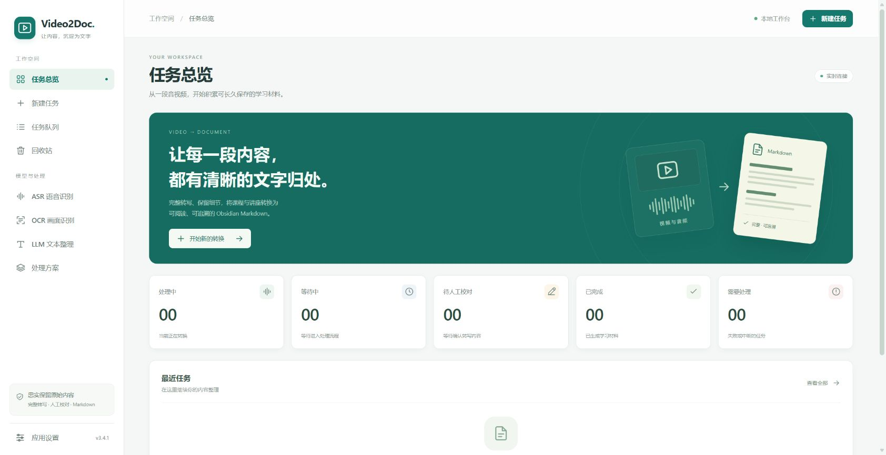

# Video2Doc

Video2Doc 是一个 Windows 优先的本地 Web 应用，把视频、音频或媒体网页链接转换为 Markdown 和可编辑 Word（`.docx`），并保留画面、识别原文和来源记录。产品原则是“质量 > 成本 > 速度”，当前不会总结、提炼观点或补充视频外知识。

[下载 Windows 便携版](https://github.com/fujingxuan/Video2Doc/releases/latest) · [使用手册](docs/USER_GUIDE.md) · [模型部署](docs/MODEL_DEPLOYMENT_REPORT.md)



## 下载与快速开始

1. 使用 Windows 10/11，并安装 Microsoft Edge。在 [Releases](https://github.com/fujingxuan/Video2Doc/releases) 下载 Windows 便携 ZIP。
2. **完整解压 ZIP 后**，双击目录中的 `Video2Doc.exe`。保留同目录的 `_internal` 等文件；这是 PyInstaller onedir 应用，单独复制 EXE 无法运行。
3. 从 [FFmpeg 官方下载页](https://ffmpeg.org/download.html) 和 [yt-dlp 官方 Releases](https://github.com/yt-dlp/yt-dlp/releases) 安装媒体工具，放入 PATH 或在“应用设置”指定路径；`ffprobe.exe` 应与 `ffmpeg.exe` 位于同一目录。**本次公开便携包不附带 FFmpeg、ffprobe 或 yt-dlp**。启动界面无需另装 Python 或 Node.js。
4. 根据任务配置 ASR/OCR Gateway。**发行包不含 ASR/OCR 模型权重及其独立运行环境**，本地模型需要另行部署，也可连接兼容的远程 Gateway；云端服务需要自行提供账号和密钥。文本整理模型是可选项。

完整要求、启动参数和构建方法见 [Windows 便携版说明](docs/WINDOWS_PORTABLE.md)。使用远程识别或文本服务时，相应音频、图片或正文会发送至所选服务。

项目代码采用 [MIT 许可证](LICENSE)。随包组件和外部模型分别受各自许可证约束，见 [第三方声明](THIRD_PARTY_NOTICES.md)。参与开发见 [贡献指南](CONTRIBUTING.md)，报告安全问题见 [安全说明](SECURITY.md)。

## 版本说明

以下保留历史更新说明；3.3.0 中“内置 yt-dlp”描述对应当时的本机构建。本次公开便携包将 yt-dlp 改为由用户单独安装。

3.4.1 在每次最终导出中同时保留同名 Markdown 和可编辑 Word（`.docx`）。Word 使用相同最终正文并内嵌相关画面；两种文件一起执行重名处理与失败回滚。任务详情支持直接打开 Word。

3.4.0 更新为浅色青绿工作台：分组侧栏与图标导航、转换引导、五类任务状态、最近任务空白引导，以及分步骤创建表单。所有模型配置、任务处理与导出能力沿用 3.3.0。

3.3.0 优化 FireRed 权重加载、优先使用 WSL 原生模型环境，内置经官方哈希校验的 yt-dlp；纯 ASR 链接任务优先下载音频，模型名称附使用场景，本地 ASR 可选 CUDA／CPU，健康检查报告实际设备、精度和加载／推理耗时。要求登录的平台链接提供明确处理提示。

## 当前状态

主应用闭环已经完成：

```text
本地视频 / 本地音频 / 媒体网页 URL
  → 输入验证
  → 本地只读引用或 yt-dlp 下载
  → ffprobe 探测
  → 可选：从视频 URL 抓取字幕轨；无轨道时 OCR 视频下方烧录字幕并跳过 ASR
  → FFmpeg 提取为 PCM 16kHz 单声道 WAV
  → 模型能力驱动分块（离线模型默认 5 秒重叠）
  → 独立 ASR Gateway（DashScope / FireRed / Qwen3 / Whisper）
  → 结构化边界去重与全局时间轴合并
  → 固定间隔 + 画面变化驱动抽帧
  → 感知哈希 + 内容区域视觉差异去重
  → 独立 OCR Gateway（本地 PaddleOCR 3.7 / PP-OCRv5 server）
  → OCR 原始响应、规范化文本块与稳定事件
  → ASR segment / OCR event / frame event 统一时间线
  → 结构化 Document IR
  → 无模型确定性整理，或多平台 OpenAI 兼容 LLM 受约束轻度编辑
  → 忠实性校验与失败回退
  → Obsidian Markdown、图片和 JSON sidecar
  → 用户指定 Vault / Inbox 原子导出
  → Windows 单入口应用查看、取消、重试和打开结果
```

所有耗时阶段仍由 SQLite 数据库队列与分阶段 Worker（转写单任务，音频可预取） 执行，不进入 API 请求线程。版本 6 不可变任务快照冻结 Gateway、文本来源、文本整理、Markdown 和导出语义；新建任务会恢复上一个任务的完整处理设置，尚未开始的队列任务可安全编辑。历史任务支持搜索、分页和虚拟滚动，当前页用 SSE 增量刷新；任务详情可按需审阅原文与实际采用正文的差异。删除任务默认移入回收站，可撤销或恢复；记录 30 天保留期，到期后由用户手动确认永久清理。只有永久删除才会在路径、任务身份与跨任务引用校验后清理生成文件，原始输入媒体始终保留。有效媒体、ASR、链接字幕抓取产物、内嵌字幕抽帧/OCR、常规帧和逐帧 OCR 可按指纹追溯或复用。文本模型不是硬依赖，且只允许轻度整理；它在一次请求中接收完整正文并返回一篇连续 Markdown 文章。结构校验、数字/术语/代码/公式/长度检查失败时会拒绝模型输出，并回退为连续原文文章；原始逐段来源关系仍保存在 Document 与 sidecar 中。

完整产品边界见 [产品需求](docs/PRODUCT_REQUIREMENTS.md)，设计见 [架构文档](docs/ARCHITECTURE.md)，阶段状态见 [实施计划](docs/IMPLEMENTATION_PLAN.md)。操作说明见 [应用使用手册](docs/USER_GUIDE.md)、[Obsidian 导出说明](docs/OBSIDIAN_EXPORT.md) 和 [Windows 便携版说明](docs/WINDOWS_PORTABLE.md)；本轮真实证据见 [3.0.0 任务管理与界面优化验收报告](docs/ITERATION_3_0_ACCEPTANCE_REPORT.md)，历史模型验收见 [2.3.0 三类模型、托管 Gateway 与画面字幕验收报告](docs/ITERATION_2_3_ACCEPTANCE_REPORT.md)。

## 技术栈

- 后端：Python 3.11+、FastAPI、Pydantic、SQLAlchemy 2、Alembic、SQLite、httpx
- 前端：React 19、TypeScript 5、Vite 7
- 外部媒体程序：FFmpeg、ffprobe、yt-dlp，均以独立进程调用
- ASR：统一 Gateway `POST /v1/asr/transcriptions`；Fun-ASR 使用 DashScope WebSocket
- OCR：独立 Gateway `POST /v1/ocr/recognitions`；本地 PaddleOCR 3.7 + PP-OCRv5 server
- 文档：类型化 Document IR、确定性忠实编辑器、可选 OneAPI 兼容文本编辑器
- 导出：Obsidian Markdown、相对附件、JSON sidecar、原子目录提交
- 图像：Pillow；媒体时间戳与候选帧由 FFmpeg `select/metadata` 提供
- 状态通信：REST + Server-Sent Events（SSE）
- 测试：pytest、受控外部进程、httpx MockTransport、Vitest

## 源码开发环境要求

- Windows 10/11 和 PowerShell 5.1+
- Python 3.11+
- Node.js 20.19+
- pnpm 11.9.0（与 `frontend/package.json` 的 `packageManager` 一致）
- FFmpeg 与 ffprobe（同一发行包）
- yt-dlp 独立可执行文件：运行 `scripts\update_media_tools.ps1` 获取到 `tools\media`，或配置其他路径 / PATH 命令
- 云端 ASR 可选 `DASHSCOPE_API_KEY`；本地 ASR 大模型可选 WSL2 + NVIDIA GPU
- 本地 OCR 使用 Windows CPU 隔离环境，不占用 ASR 显存

公开便携包不提供 FFmpeg、ffprobe 或 yt-dlp，需要用户另行安装。源码开发时可通过下列脚本从 yt-dlp 官方 Release 下载，并核对官方 SHA-256 清单。应用会查找自定义构建包内的 yt-dlp、仓库 `tools\media\yt-dlp.exe` 和 PATH，设置页可指定其他路径。三类媒体命令均以独立进程执行，使用异步流式日志、超时、取消和 Windows 进程树终止。

不要从不可信来源下载可执行文件。安装后运行：

```powershell
Set-Location D:\Projects\Video2Doc
.\scripts\update_media_tools.ps1
.\scripts\check_media_tools.ps1 -YtDlp .\tools\media\yt-dlp.exe
```

检查脚本默认只查询 PATH；上述 `-YtDlp` 参数指定仓库内的可执行文件。若 FFmpeg 不在 PATH，可为脚本传入 `-Ffmpeg`、`-Ffprobe`，并在“应用设置”中填写 FFmpeg 的完整路径。应用中的 ffprobe 默认取 FFmpeg 同目录下的 `ffprobe.exe`。

## 从源码安装

先在自己的项目目录克隆仓库。后文的 `D:\Projects\Video2Doc` 是示例路径，可替换为实际位置。

```powershell
git clone https://github.com/fujingxuan/Video2Doc.git
Set-Location Video2Doc
Copy-Item .env.example .env
.\scripts\setup.ps1
```

`setup.ps1` 安装 Python/前端依赖并检查媒体命令；媒体命令缺失时会明确警告，但仍允许先启动应用并在设置页补充路径。

本地 OCR Runtime 单独安装，不把 PaddlePaddle 放入后端环境：

```powershell
.\scripts\model_runtime\setup_ocr_gateway.ps1
.\scripts\model_runtime\start_ocr_gateway.ps1
.\scripts\model_runtime\test_ocr_gateway.ps1 `
  -Image D:\path\to\frame.jpg `
  -Output D:\path\to\ocr-response.json
```

默认只绑定 `127.0.0.1:8201`，停止命令为 `.\scripts\model_runtime\stop_ocr_gateway.ps1`。模型和环境默认保存在 `D:\Models\Video2Doc`，不提交到 Git。

编辑 `.env`：

```dotenv
ONEAPI_BASE_URL=https://your-oneapi.example/v1  # 仅文本处理
ONEAPI_API_KEY=replace-with-local-secret
DASHSCOPE_API_KEY=replace-with-local-secret
# DASHSCOPE_WORKSPACE_ID=optional-workspace-id
```

真实密钥可来自未提交的 `.env`、进程环境变量，或由 Windows 当前用户 DPAPI 加密后保存。SQLite 中手工配置的密钥以密文保存；前端响应、任务快照和日志不保存明文密钥。

## 数据库迁移

```powershell
Set-Location D:\Projects\Video2Doc\backend
.\.venv\Scripts\python.exe -m alembic upgrade head
.\.venv\Scripts\python.exe -m alembic current
.\.venv\Scripts\python.exe -m alembic check
```

`0005_independent_model_gateways` 新增独立 ASR/OCR Gateway；`0006_ocr_fusion_artifacts` 新增帧、OCR 与融合产物；`0007_document_exports` 新增文档、文本编辑与导出记录；`0008_v2_traceable_inputs` 新增逐阶段模型记录，并把成品无时间戳设为默认；`0009_three_model_credentials` 新增 LLM Provider/Base URL 与 Windows DPAPI 密钥字段。新任务使用快照版本 6，额外冻结文本来源、链接字幕与内嵌 OCR 策略、文本模型、提示词/模板版本、忠实性阈值、图片策略、直接导出目录、文件名与冲突策略和 sidecar 开关；快照只保存密钥来源状态，不保存密钥值。

## 启动

便携版推荐直接运行：

```powershell
D:\Projects\Video2Doc\dist\Video2Doc-Portable\Video2Doc.exe
```

程序会升级自己的 SQLite、检查端口、启动 FastAPI、托管已构建前端并打开 Edge 独立应用窗口。该窗口禁用浏览器扩展，避免插件欢迎页抢占应用；点击窗口右上角 X 会停止由该窗口启动的 Video2Doc 后端，不停止外部管理的 Docker OCR。完整参数和隔离数据目录方式见 [Windows 便携版说明](docs/WINDOWS_PORTABLE.md)。

2.2.1 使用 Windows 单实例锁和按窗口标题跟踪：重复双击只会尝试唤醒已有窗口，不会再创建第二个 Edge 窗口，也不会误关正在运行的后端。侧边栏版本号直接来自前端包版本。

开发环境仍可分别启动：

后端：

```powershell
Set-Location D:\Projects\Video2Doc
.\scripts\start_backend.ps1
```

前端：

```powershell
Set-Location D:\Projects\Video2Doc
.\scripts\start_frontend.ps1
```

联合启动：

```powershell
.\scripts\start_dev.ps1
```

- 前端：<http://127.0.0.1:5173>
- API：<http://127.0.0.1:8000>
- 健康检查：<http://127.0.0.1:8000/api/v1/health>
- OpenAPI：<http://127.0.0.1:8000/docs>

`Ctrl+C` 会停止前后端；后端停止时会终止受管外部进程树并把任务置为 `INTERRUPTED`，供用户显式重试。

## 支持的输入

- 本地视频文件
- 本地音频文件
- yt-dlp 支持的视频网页和媒体 URL

本地输入必须是存在的绝对文件路径。应用不会只根据扩展名认定媒体有效，而是最终以 ffprobe 流信息为准。当前浏览器不能安全返回任意本地绝对路径，因此前端使用路径输入；后端仍执行完整验证。

Windows 便携版和本机开发版可通过后端 WinForms 选择媒体和导出目录；手工粘贴路径仍受相同校验。本地媒体采用“只读引用原文件”策略；URL 媒体下载到任务工作区。链接字幕由 yt-dlp 写入当前任务工作区，不修改任何本地原文件。外部命令始终使用参数列表启动，不经过 shell 拼接用户输入。

## 文本来源与任务级导出

新建任务时可选择：

- `ASR 语音识别`：使用方案或本次任务选定的 ASR Gateway 模型；
- `从链接抓取字幕`：仅用于视频网页 URL；先由 yt-dlp 抓取字幕轨，再尝试 B 站播放器字幕接口；可选的嵌入字幕 OCR 回退会密集抽取视频下方区域并生成 SRT，整个模式完全跳过音频提取和 ASR 模型调用。

字幕模式可批量填写视频 URL，每个任务只处理自己链接对应的字幕。启用嵌入字幕 OCR 后需要选择 OCR 模型；没有轨道且画面下方也没有稳定文字时以 `EMBEDDED_SUBTITLE_NOT_FOUND` 明确失败。任务详情中的每个阶段都会显示实际模型，未调用模型的本地阶段会明确标注；历史任务可根据不可变快照补全模型名称。任务创建页可直接选择任意成品目录，最终 Markdown、附件和追溯 sidecar 原子写入该目录。新任务的成品 Markdown 默认不写入媒体时间戳或生成时间字段，原始 JSON/SRT 仍保留时间信息用于追溯。

## ASR 配置

1. 在“ASR”页面创建或启用 ASR Gateway，填写协议、Base URL 与密钥来源；内置本地 Gateway 会在任务需要时自动启动。
2. 执行健康检查和模型发现，或手动添加模型及其能力上限。
3. 在处理方案中分别选择 ASR Gateway 模型、OCR Gateway 模型与 LLM 文本模型。
4. 云端密钥可通过环境变量名称（例如 `DASHSCOPE_API_KEY`）执行时读取，或用 Windows 当前用户 DPAPI 加密保存；API 与快照均不回显密钥。

统一 ASR 协议使用 multipart 字段 `file`、`model`、`language`、`timestamp_granularity`、`prompt` 和 `task`。Fun-ASR 对完整音频保持单一连续流；只有连接限制或恢复需要拆会话时才使用 5 秒重叠，连续会话绝不重复发送音频。

## OCR 配置

1. 启动 `local-paddleocr` Gateway，并在 Gateway 页确认健康状态与模型发现。
2. 在处理方案或新任务页选择 `PP-OCRv5_server`，启用 OCR。
3. 按内容调整固定采样间隔、场景变化阈值、最大候选帧数和融合窗口。
4. 任务详情显示候选/保留/丢弃帧、OCR 块数、OCR 事件和融合事件，并可打开工作区内关键产物。

默认使用混合采样。根据媒体时长和最大候选数推导最小选择间隔，因此 FFmpeg 会扫描完整媒体时间线而不是达到数量后提前结束。相似度特征忽略画面底部 20% 的常见字幕区，以降低字幕轻微变化造成的误保留；证据不足时保留帧并记录比较依据。

## 真实 Pipeline 阶段与进度

| 阶段 | 进度来源 |
| --- | --- |
| `INPUT_VALIDATE` | 输入规则和文件存在性 |
| `MEDIA_ACQUIRE` | yt-dlp 实际下载百分比；本地引用直接完成 |
| `MEDIA_PROBE` | ffprobe 阶段状态（不可精确计量） |
| `AUDIO_EXTRACT` | FFmpeg `out_time` / 媒体总时长 |
| `AUDIO_VALIDATE` | 音频文件和标准化流检查 |
| `AUDIO_CHUNK` | 已完成分块数 / 总分块数 |
| `ASR_TRANSCRIBE` | 已完成 ASR 分块数 / 总分块数 |
| `ASR_COMBINE` | 全局时间轴映射和产物写入 |
| `ASR_VALIDATE` | 结果顺序、时间戳和文本检查 |
| `SUBTITLE_IMPORT` | 从视频 URL 抓取并解析字幕；明确不调用 ASR |
| `SUBTITLE_NORMALIZE` | 字幕段落与原始时间轴规范化 |
| `SUBTITLE_VALIDATE` | 字幕正文与时间顺序检查 |
| `FRAME_EXTRACT` | FFmpeg 已扫描媒体时间 / 媒体总时长 |
| `FRAME_DEDUP` | 候选、保留、丢弃计数与决策校验 |
| `OCR_RECOGNIZE` | 已完成 OCR 帧数 / 保留帧数及复用数 |
| `OCR_TIMELINE` | 稳定重复页合并与增量变化事件 |
| `FUSION_BUILD` | ASR/OCR/帧统一事件构建 |
| `FUSION_VALIDATE` | 时间范围、排序、引用和产物索引校验 |
| `DOCUMENT_BUILD` | 从融合事件生成类型化 Document IR 和来源引用 |
| `TEXT_EDIT` | 无模型确定性整理，或受约束文本模型编辑与忠实性验证 |
| `MARKDOWN_RENDER` | frontmatter、无时间戳正文、图片和追溯附录渲染 |
| `OBSIDIAN_EXPORT` | 路径验证、附件/sidecar 复制和原子提交 |
| `FINALIZE` | 产物索引和任务最终状态 |

总进度由上述真实状态映射，不使用固定 sleep 伪造。无法得到比例的步骤只显示阶段级状态。

## 工作区

每个任务仍使用带 UTC 创建时间和任务 ID 的独立目录：

```text
<data>/YYYYMMDD_HHMMSS_<safe-title>_<task-id>/
├── 00_source/
│   ├── media/                       # URL 下载媒体
│   └── metadata/
│       ├── input.json
│       ├── media_acquisition.json
│       ├── ytdlp.json               # URL 原始元数据
│       ├── ffprobe.json             # 原媒体原始探测
│       ├── media_info.json          # 标准化媒体信息
│       └── audio_media_info.json
├── 01_extract/
│   ├── audio/normalized.wav
│   ├── chunks/
│       ├── manifest.json
│       └── chunk_0000.wav
│   └── frames/
│       ├── manifest.json
│       ├── candidates/frame_000000.jpg
│       └── normalized/frame_000000.jpg
├── 02_asr/
│   ├── provider_raw/attempt_0001/   # Provider 原始响应，按 attempt 隔离
│   ├── raw.json                     # 原始响应索引和分段
│   ├── normalized.json              # 版本化标准结果
│   ├── raw.txt
│   ├── raw.srt
│   └── preview.json
├── 03_ocr/
│   ├── provider_raw/attempt_0001/
│   ├── normalized/frames/
│   ├── raw.json
│   ├── normalized.json
│   ├── preview.json
│   └── timeline.json
├── 04_fusion/
│   ├── input.json
│   ├── timeline.json
│   ├── preview.json
│   └── intermediate/
├── 05_output/
│   ├── document.json               # 类型化 Document IR
│   ├── text_edit.json              # 原文、编辑结果、验证和回退记录
│   ├── note.md                     # 工作区 Markdown 副本
│   └── export.json                 # 最终导出索引
├── logs/                            # stdout/stderr 与任务日志
├── artifacts.json
├── task_config.json
└── task_state.json
```

临时文件使用 `.part`/`.tmp` 名称，成功后原子替换；失败或取消会删除不完整媒体、音频分块和候选帧。原始 ASR/OCR 响应与规范化结果分离，后续阶段不得覆盖它们。

## 取消、超时和重试

- 等待任务取消后立即进入 `CANCELLED`。
- 运行任务写入持久化 `cancel_requested`；Provider 停止提交新分块。
- 外部命令通过统一异步执行器持续读取 stdout/stderr，并在 Windows 使用 `taskkill /T /F` 终止完整进程树，失败时再强制终止父进程。
- ASR 请求取消时取消本地 HTTP 协程；取消后返回的远端结果不会保存。
- OCR 请求使用同一关闭/取消信号；取消后不会保存晚到响应，也不会继续提交后续帧。
- 媒体命令默认超时 3600 秒，ASR 单请求默认超时 300 秒。
- ASR 对超时、网络错误、HTTP 429 和 5xx 最多重试 2 次并指数退避；认证和其他 4xx 不重试。
- `FAILED`/`INTERRUPTED` 可重试。重试增加 attempt，但继续使用创建时的原始配置快照。
- 重试会复用有效的媒体、探测、标准化音频、分块、前一 attempt ASR 响应、帧清单和逐帧 OCR；帧/OCR 复用要求媒体、配置、模型和图像内容指纹一致，不复用不完整 `.part` 文件。

可在 `.env` 调整：

```dotenv
VIDEO2DOC_MEDIA_TIMEOUT_SECONDS=3600
VIDEO2DOC_ASR_TIMEOUT_SECONDS=300
VIDEO2DOC_ASR_MAX_RETRIES=2
VIDEO2DOC_AUDIO_CHUNK_SECONDS=60
VIDEO2DOC_ASR_OVERLAP_SECONDS=5
VIDEO2DOC_PROCESS_POLL_SECONDS=0.20
```

`VIDEO2DOC_AUDIO_CHUNK_SECONDS` 只是兼容回退值，实际块长受 Gateway 模型能力上限约束。所有离线分块默认 5 秒重叠，`step_seconds = chunk_seconds - 5`；manifest 保存源时间范围、前后重叠、Provider、模型、attempt 和状态。合并层先用时间戳与规范化文本做确定性去重，不把边界重复留给后续大模型清洗；同一源窗口内足够长的相似词前缀可消除 ASR 拼写漂移造成的重复，但未匹配的边缘新词会保留。不确定冲突写入诊断，互相矛盾的词时间置 `null` 而不伪造新时间。

## API

在原有任务、队列、取消、重试、快照和 SSE API 之外，新增：

- `GET /api/v1/tasks/page?offset=0&limit=100&status=COMPLETED&search=课程&trashed=false`：当前页、总数及实际 offset；limit 范围 1–200
- `GET /api/v1/events/pages`：同样的分页参数；首次 `page`，随后 `delta`，无变化时 keep-alive
- `DELETE /api/v1/tasks/{id}`：移入回收站，返回 Task（删除语义已变更）
- `POST /api/v1/tasks/{id}/restore`：恢复任务
- `DELETE /api/v1/tasks/{id}/permanent`：永久删除已经移入回收站的任务及生成物
- `POST /api/v1/tasks/trash/purge-expired`：确认后手动清理最多 100 个过期项，返回成功项与跳过原因
- `GET /api/v1/tasks/{id}/review`：已保存原文、实际采用正文及完整差异
- `GET /api/v1/tasks/{id}/review/diff`：下载完整逐行差异

- `GET /api/v1/tasks/{id}/media`
- `GET /api/v1/tasks/{id}/transcript`
- `GET /api/v1/tasks/{id}/artifacts`
- `GET /api/v1/tasks/{id}/frames`
- `GET /api/v1/tasks/{id}/ocr`
- `GET /api/v1/tasks/{id}/timeline`
- `GET /api/v1/tasks/{id}/document`
- `GET /api/v1/tasks/{id}/markdown`
- `POST /api/v1/tasks/{id}/open/{workspace|export_directory|markdown}`
- `GET /api/v1/tasks/{id}/artifacts/{relative-path}`
- `GET /api/v1/system/status`
- `POST /api/v1/system/select-media`
- `POST /api/v1/system/shutdown`
- `GET/POST/PUT/DELETE /api/v1/gateways`
- `POST /api/v1/gateways/{id}/health`
- `POST /api/v1/gateways/{id}/discover`
- `GET/POST/PUT/DELETE /api/v1/gateway-models`

任务详情响应也包含媒体摘要、转写预览、帧统计、OCR 预览、融合预览、真实阶段进度和产物清单。单文件产物接口拒绝越出任务工作区。技术错误与用户可读错误分离，完整 stderr 不直接作为用户提示。

## 测试与构建

```powershell
Set-Location D:\Projects\Video2Doc
.\scripts\test_check_media_tools.ps1

Set-Location D:\Projects\Video2Doc\backend
.\.venv\Scripts\python.exe -m ruff check --no-cache app tests
.\.venv\Scripts\python.exe -m pytest -q

Set-Location D:\Projects\Video2Doc\frontend
pnpm typecheck
pnpm test
pnpm build

Set-Location D:\Projects\Video2Doc
.\scripts\build_portable.ps1
```

默认自动化测试不依赖公网或真实凭据：使用短生命周期受控进程、受控 yt-dlp/FFmpeg/OCR Provider、httpx MockTransport 和数据库 Worker 集成测试，验证成功、错误、超时、取消、时间轴、视觉去重、OCR、文档 IR、忠实性校验、Markdown、原子导出、迁移、快照与重试复用。真实模型/媒体验收通过显式 opt-in 测试执行，不替代自动化回归。

## Windows 手工验收

仓库验收使用 `D:\Video2Doc-Test\sample.mp4`、自动提取的 `sample-asr-short.wav` 与文档记录的公开 URL：

1. 运行 `check_media_tools.ps1`。
2. 配置独立 ASR 与 OCR Gateway；OneAPI 只配置可选文本轻度编辑模型。
3. 分别创建本地音频、本地视频和 URL 任务。
4. 在任务详情核对媒体流、阶段进度、帧/OCR/融合/文档统计、Markdown 预览和导出位置。
5. 分别在下载、FFmpeg、ASR、抽帧和 OCR 阶段取消任务，确认任务停止、文件句柄释放且无残留进程。
6. 对失败/中断任务执行重试，核对 attempt 增加、快照不变，并只复用指纹一致的帧/OCR。
7. 启动便携版，验证前端、健康检查、任务读取/创建、缺失 Gateway 提示和退出清理。

ASR 部署与横向结果见 `docs/MODEL_DEPLOYMENT_REPORT.md`、`docs/ASR_MODEL_COMPARISON.md`；OCR 部署与真实全链路结果见 `docs/OCR_MODEL_DEPLOYMENT_REPORT.md`、`docs/OCR_FUSION_ACCEPTANCE_REPORT.md`。

## 已知限制

- 当前只支持单后端进程、单任务并发；不支持多实例或分布式队列。
- 当前离线分块使用固定能力上限与 5 秒重叠，尚未加入 VAD 边界微调。
- Provider 若只返回整段文本而不返回 segment 时间戳，对应标准字段保持 `null`，不会伪造时间。
- 新页面使用有界快照与 SSE 增量更新，重连重新同步；旧 `/tasks` 列表和 `/events` 全量快照接口保留兼容，不是可重放事件日志。
- 当前视觉去重使用内容裁剪 dHash 与灰度像素差异，不是语义视觉模型；边缘情况按保留优先。
- OCR 事件只做确定性空白清理、块级去重和相似页合并，不补写、改写或总结识别文本。
- Windows 发行物是便携目录/ZIP，不是带自动升级和卸载器的 MSI 安装包。
- 前端由隔离配置的 Edge 应用模式窗口显示；当前没有内嵌 WebView 或系统托盘。
- 浏览器内 Markdown 预览是文本预览，不模拟 Obsidian 的完整主题与插件渲染。
- RAG、问答、自动总结、向量数据库、Embedding 和语义搜索是永久排除功能，不是待办事项。


### 3.1.0 更新

支持浏览器上传本地音频；未启用文本模型时，转写后可下载初稿交给网页大模型校对、粘贴或导入修改稿后完成，也可直接使用初稿。等待校对不占用队列，保存后可跨重启继续，导出重试不重复转写。字幕优先抓取、备用语言/接口及 JSON3 支持已加强。详见 [使用手册](docs/USER_GUIDE.md) 与 [3.1.0 验收记录](docs/ITERATION_3_1_ACCEPTANCE_REPORT.md)。
